# Flutter JSON Editor

A Flutter widget that dynamically generates interactive forms from [JSON Schema (Draft 7)](https://json-schema.org/draft-07). Drop in a schema, get a fully functional form — with validation, nested objects, arrays, conditional fields, and more.

**Warning:** This sideproject was implemented mainly using AI tools. Use it with a bigger grain of salt than with other open source projects you're using.

## The Idea

Building forms by hand is tedious. Building forms that mirror a complex, evolving data model is worse. JSON Schema already describes your data structure, constraints, and validation rules — so why not let the schema *be* the form?

Obviously this is nothing new and we took inspiration from the Javascript [JSON Editor](https://github.com/json-editor/json-editor) project we successfully used in web projects back in time. We wanted to have that for a long time in Flutter and the raise of AI tools
gave us the help we needed.

The Flutter JSON Editor takes a JSON Schema and renders a complete, editable form widget. When the user changes a value, you get the full data object *and* a precise diff of what changed. No form-builder boilerplate, no manual field wiring — just schema in, data out.

Take the example project for s spin and judge for yourself. Feel free to suggest extensions, but make sure they always support i18n and don't introduce new dependencies. We want to keep this package small and rather provide a companion project with additional niche editors.

## Features

- **Full type coverage** — String, number, integer, boolean, enum, object, array, map, colour picker, date/time, and SVG part picker editors out of the box
- **Nested structures** — Objects within objects, arrays of objects, maps with dynamic keys
- **Conditional fields** — `if`/`then`/`else` branches show and hide fields based on data state
- **Property dependencies** — Fields that appear or become required based on other field values
- **Composition** — `oneOf` and `anyOf` with automatic variant detection
- **Inline validation** — Field-level error messages derived from schema constraints
- **Remote `$ref` resolution** — Async lookup for external schema references with caching, dropdown or typeahead based on result count
- **Partial forms** — `visiblePaths` whitelists which fields render; hidden data is still returned in full
- **Diff tracking** — `DiffCalculator` reports only the paths that changed between updates
- **Theming** — `JsonEditorTheme` extension integrates with your Material 3 theme
- **Custom editors** — `EditorRegistry` lets you override any field by path, `x-format`, type, or predicate
- **Built-in format editors** — `x-format` or standard `format` activates colour wheel, star rating, slider, stepper, segmented buttons, filter chips, duration, signature pad, photo from library or camera (base64), photo gallery, linear/NPS/emoji scales, matrix (Likert grid), ranking, date range, phone number, file upload (base64), consent with links, textarea, image picker, picture choice, date/time pickers, SVG part picker, and Markdown renderer
- **Form-builder extras** — wizard, tabs, card and collapsible section layouts, input masks, units and currencies, hidden fields, calculated fields (JSON Logic) and answer piping into titles
- **LLM support** — a guide, `llms.txt`, a meta-schema and `SchemaLint` with fix-it messages, so models can generate forms and check them
- **Circular reference protection** — Self-referential schemas are safely capped at a configurable depth

## Getting Started

Add the dependency to your `pubspec.yaml`:

```yaml
dependencies:
  flutter_json_editor:
    git:
      url: https://github.com/safenow/flutter_json_editor.git
```

The editor is built on [`material_ui`](https://pub.dev/packages/material_ui), the Material library decoupled from the Flutter framework, so your app has to use `package:material_ui/material_ui.dart` as well. Apps still on the framework's `package:flutter/material.dart` can use the `renderer/material` branch (version 0.6.x):

```yaml
dependencies:
  flutter_json_editor:
    git:
      url: https://github.com/safenow/flutter_json_editor.git
      ref: renderer/material
```

## Basic Usage

```dart
import 'package:flutter_json_editor/flutter_json_editor.dart';
import 'package:json_schema/json_schema.dart';

final schema = JsonSchema.create({
  'type': 'object',
  'properties': {
    'name': {'type': 'string'},
    'age': {'type': 'integer', 'minimum': 0},
    'active': {'type': 'boolean', 'default': true},
  },
  'required': ['name'],
});

JsonEditor(
  schema: schema,
  initialData: {'name': 'Jane', 'age': 30},
  onUpdate: (data, diff) {
    print('Full data: $data');
    print('Changed: $diff');
  },
)
```

## How It Works

### Schema Resolution

When the widget builds, `SchemaResolver` walks the schema and picks the right editor for each field. The resolution order is:

1. **Registry overrides** — your custom editors (by path, `x-format`, predicate, or type)
2. **Remote `$ref`** — URL references resolved via async callback
3. **`$ref` resolution** — local references followed (with circular depth protection)
4. **Composition** — `oneOf`/`anyOf` render a variant selector
5. **Enum** — enumerated values render a dropdown
6. **Type** — matched to the corresponding editor widget
7. **Structural fallback** — properties present → object editor; additionalProperties → map editor
8. **Default** — falls back to a string input

### Data Flow

```
JsonEditor
  ├── Wraps children with EditorRegistry + RefLookupProvider
  └── Calls SchemaResolver.resolve() for the root schema
        └── Returns the appropriate editor widget

Each editor:
  ├── Renders its input controls
  ├── Validates via ValidationHelper
  └── Calls onChanged(updatedValue) on user input

JsonEditor._onRootChanged()
  ├── Stores updated data
  ├── Computes diff via DiffCalculator
  └── Fires onUpdate(fullData, diff)
```

### Reading Current Data

Use a `GlobalKey` to access the editor state at any time:

```dart
final editorKey = GlobalKey<JsonEditorState>();

// Later…
final currentData = editorKey.currentState?.currentData;
```

## Partial Forms

Pass `visiblePaths` to render only a slice of a large schema. The whitelist
affects **rendering only** — the editor keeps the object it was handed and
returns it in full from `onUpdate`, so values behind hidden fields survive the
round-trip untouched.

```dart
JsonEditor(
  schema: bigSchema,
  initialData: partiallyFilledObject,
  // Only these three fields are shown; everything else is kept, not rendered.
  visiblePaths: const ['name', 'address.zip', 'contacts[*].email'],
  onUpdate: (fullData, diff) => save(fullData), // fullData is the whole object
)
```

This is built for agentic flows: an LLM inspects a large input object, works out
which fields are still missing, and shows the user just those — a short form
instead of a wall of inputs — then writes the complete object back.

```dart
final missing = findMissingRequired(schemaMap, data); // returns keys + titles
JsonEditor(
  schema: schema,
  initialData: data,
  visiblePaths: missing.map((f) => f.key).toList(),
  onUpdate: (fullData, _) => save(fullData),
);
```

### Path Syntax

| Path | Matches |
|---|---|
| `name` | top-level property |
| `address.zip` | nested property |
| `contacts[0].email` | that property on one specific array item |
| `contacts[*].email` | that property on every array item |
| `tags[*]` | every item of a scalar array |
| `address.*` | every direct child of `address` |

JSON Pointer is accepted too and normalized on the way in, so `/address/zip`
and `/contacts/0/email` work — validator output can be passed straight through.

### Matching Rules

A node renders when its path **is** a whitelist entry, is a **descendant** of
one, or is an **ancestor** of one:

- **Descendant-or-self** — the whole subtree renders, unfiltered. `'address'`
  shows every field of the address object.
- **Ancestor** — the container renders as a shell for its whitelisted
  descendants only. `'address.zip'` shows the address section containing just
  the zip field.

Two consequences worth knowing:

- A container whose every field was filtered out renders nothing — no empty
  header or border is left behind.
- An array or map reached only through a **concrete** index or key
  (`contacts[0].email`, `meta.author`) hides its add, delete, and reorder
  controls, and map keys become read-only: those edits would slide fields out
  from under the whitelist. A **wildcard** whitelist (`contacts[*].email`,
  `meta.*`) applies equally to every item, so editing stays enabled.

For full control, build the whitelist yourself and pass it as `visibility`
(which takes precedence over `visiblePaths`):

```dart
JsonEditor(
  schema: schema,
  visibility: FieldVisibility.whitelist(['name', 'address.zip']),
)
```

`FieldVisibility.all()` is the explicit "no filtering" value, and the same
predicates the editors use — `isVisible`, `isSubtreeVisible`,
`allowsStructuralEdits` — are public if you need to reason about a whitelist
outside the widget tree.

## Layouts and Form Logic

### Section Layouts

`x-layout` on a nested `object` sets how its fields are grouped:

| `x-layout` | Look |
|---|---|
| *(none)* | Titled group (the default) |
| `"card"` | Filled card with a border |
| `"collapsible"` | Header that folds the fields away; starts open unless `"x-collapsed": true` |
| `"plain"` | No title or frame, the fields sit in the parent's column |
| `"wizard"` | One property per step, with a progress bar and back/next buttons |
| `"tabs"` | One property per tab; switch freely between them |

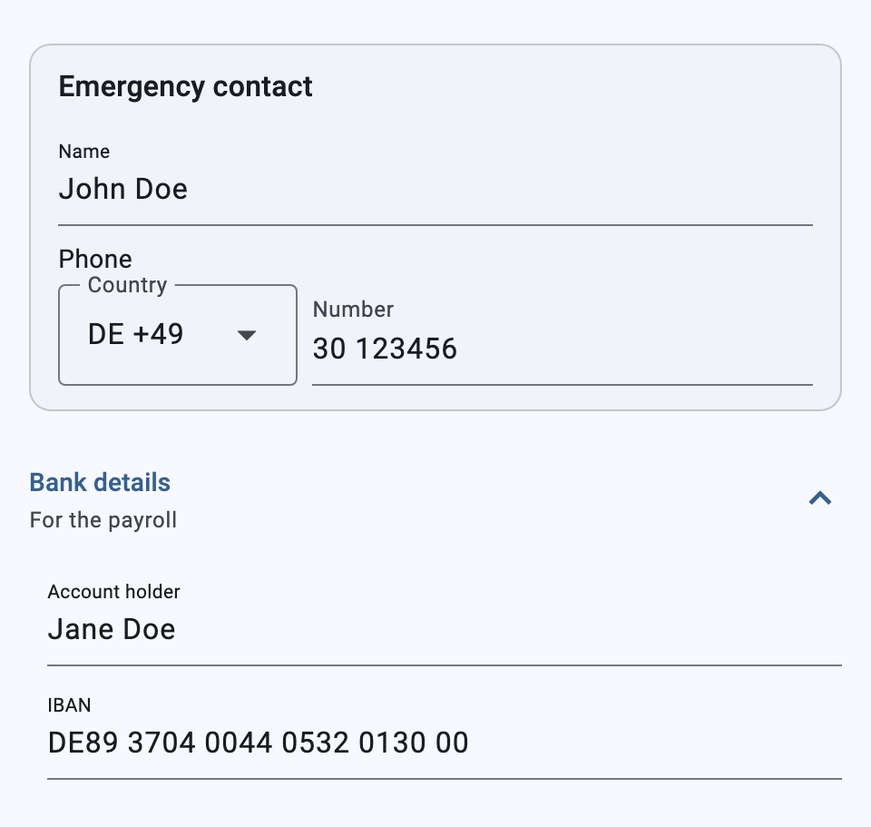 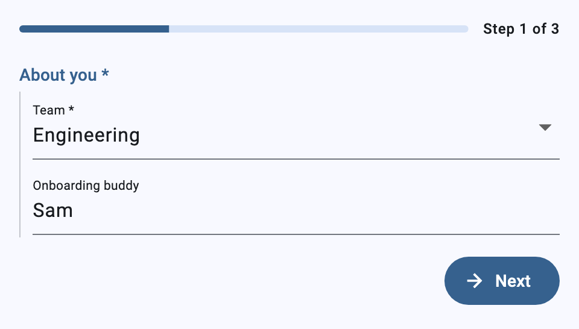 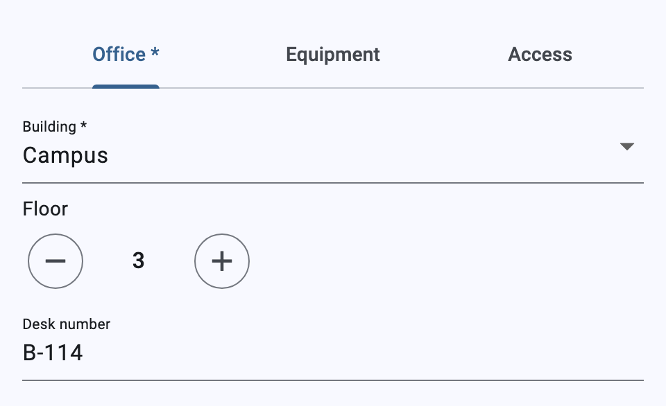

A wizard won't go to the next step until the current one is complete, meaning its required answers are given and its value is valid. The last step shows "Finish" when the `JsonEditor` has an `onSubmit`, which receives the current data:

```dart
JsonEditor(
  schema: schema,
  onChanged: (data) {},
  onSubmit: (data) => api.send(data),
)
```

Tabs group the same way as a wizard, but you can switch to any tab at any time. Each tab is labelled with its property's title, and a required property gets a `*`. An object on a tab shows its fields without a header of its own; its description appears above them. If you leave a tab with missing or invalid answers, an error mark appears on it. Once the answers are complete, the mark goes away. With more than three tabs, the tab bar scrolls.

```json
{"workplace": {"type": "object", "x-layout": "tabs", "required": ["office"],
  "properties": {
    "office": {"type": "object", "title": "Office", "properties": {"building": {"type": "string"}, "desk": {"type": "string"}}},
    "equipment": {"type": "object", "title": "Equipment", "properties": {"items": {"type": "array", "x-format": "chips", "items": {"enum": ["Headset", "Webcam"]}}}}
  }}}
```

### Hidden Fields

`"x-hidden": true` keeps a property in the data but never shows it. It suits values the app fills in, such as a source, a campaign or an ID, through `initialData` or a calculation.

### Calculated Fields

`x-calc` holds a [JSON Logic](https://jsonlogic.com) rule, and the field always shows the rule's result. Make such fields `readOnly`. Rules read the whole form (`{"var": "order.total"}`). A path starting with a dot reads from the object that holds the field (`{"var": ".price"}`), which helps inside array items. One calculation may use another's result. Fields that depend on each other in a circle show an error and keep their last value.

```json
{
  "commute": {"type": "number", "title": "Commute", "x-unit": "km"},
  "officeDays": {"type": "integer", "title": "Office days per week"},
  "commuteYearly": {
    "type": "number", "title": "Commute per year", "x-unit": "km", "readOnly": true,
    "x-calc": {"round": [{"*": [2, {"var": ["commute", 0]}, {"var": ["officeDays", 0]}, 46]}, 0]}
  }
}
```

The evaluator is the package's own: rules are data, not code, so they can't loop forever or reach anything outside the form. It supports `var`, `missing`, `missing_some`, `if`/`?:`, `==`, `===`, `!=`, `!==`, `!`, `!!`, `and`, `or`, `<`, `<=`, `>`, `>=` (`<`/`<=` also as "between" with three arguments), `+`, `-`, `*`, `/`, `%`, `min`, `max`, `map`, `filter`, `reduce`, `all`, `none`, `some`, `merge`, `in`, `cat` and `substr`. It adds two operators: `round` (`{"round": [value, digits]}`) and `count` (non-null items). `JsonLogic.apply` and `FormCalculator.apply` are exported, so the server can recompute and check the same rules.

### Piping Answers

`{{path}}` in a `title` or `description` is replaced by the answer at that path, for example `"Anything else, {{firstName}}?"`. `{{.key}}` reads from the enclosing object. Until the field is answered, it shows `…`. `pipeText` is exported for use elsewhere.

## LLM Support

Forms are plain JSON, so an LLM can write them. The package ships what one needs to do it well, all generated from a single catalog of editors (`lib/src/catalog/editor_catalog.dart`):

| File | What it is |
|---|---|
| [`llms.txt`](llms.txt) | Entry point by the [llms.txt](https://llmstxt.org) convention: what the package is, links to the rest |
| [`doc/llm-guide.md`](doc/llm-guide.md) | Rules, a "which editor for which question" table, and one entry per editor and layout: use for, applies to, keys, what it stores, a minimal example, common mistakes; plus form logic, keywords and data-size limits |
| [`schema/flutter_json_editor.schema.json`](schema/flutter_json_editor.schema.json) | Draft-07 meta-schema: validates a form schema's `x-` keywords, with a description each. Its `x-catalog` holds the lint rules as data, for linters in other languages |
| [`example/assets/forms/`](example/assets/forms) | Complete forms: a survey, an onboarding wizard with tabs, an order with calculations, an inspection with photos and a signature |

Hand the guide (or `llms.txt`) to the model as context, then check what it writes:

```dart
final issues = SchemaLint.check(schema);
// [error /properties/rating: "slider" needs "type": "number" or "integer";
//  the field falls back to its default editor.]
```

A wrong schema rarely fails: an `x-format` on the wrong type, a `chips` field without choices or a 20-step `linear-scale` silently render a default editor instead. `SchemaLint` finds these, plus misplaced or mistyped keywords, unknown `x-layout`s, `x-calc` rules with unknown operators, missing fields or cycles, `{{piping}}` to missing fields, and photo or file fields without size limits. Each issue has a JSON Pointer `path`, a `code`, a `severity` (`error`: renders differently than meant; `warning`: likely a mistake) and a `message` that says how to fix it, so the loop is simple: generate, lint, feed the messages back, repeat until no errors remain. `SchemaLint.check` works on the plain `Map` without Flutter, so a server can run it too; pass `formats:` and `keywords:` for the app's own `x-format`s and keywords.

The documents are checked in and tested: after changing an editor, update its entry in the catalog and run `UPDATE_LLM_DOCS=1 flutter test test/llm_docs_test.dart`. The same test fails when the files are stale, when a built-in format has no entry, and when an entry's example doesn't lint clean or render.

## Theming

Apply a `JsonEditorTheme` via your app's `ThemeData`:

```dart
ThemeData(
  extensions: [
    JsonEditorTheme(
      fieldSpacing: 4.0,
      sectionSpacing: 8.0,
      fieldPadding: const EdgeInsets.symmetric(vertical: 2.0),
      requiredIndicatorColor: Colors.red,
    ),
  ],
)
```

If no theme extension is provided, sensible defaults are derived from your Material theme.

## Custom Editors

Override how specific fields are rendered using `EditorRegistry`:

```dart
JsonEditor(
  schema: schema,
  registry: EditorRegistryData(
    // Override by exact field path
    pathOverrides: {
      'address.zip': ({required schema, required path, required value,
          required onChanged, required isRequired, isNullable = false}) =>
          MyCustomZipEditor(value: value, onChanged: onChanged),
    },
    // Override by x-format value
    formatOverrides: {
      'star-rating': ({required schema, required path, required value,
          required onChanged, required isRequired, isNullable = false}) =>
          MyStarRatingEditor(value: value, onChanged: onChanged),
    },
    // Override by schema type
    typeOverrides: {
      SchemaType.string: ({required schema, required path, required value,
          required onChanged, required isRequired, isNullable = false}) =>
          MyFancyStringEditor(schema: schema, value: value, onChanged: onChanged),
    },
  ),
)
```

### Built-in Format Editors

The library ships with built-in editors activated via the `x-format` schema extension. These work automatically without any registry configuration:

| `x-format` / `format` value | Editor | Stored format |
|---|---|---|
| `"colour"` or `"color"` | Interactive HSV colour wheel with brightness slider | `#rrggbb` hex string (e.g. `"#ff0000"`) |
| `"star-rating"` | Clickable 0–5 star rating | `int` or `String` depending on schema type |
| `"image-url-picker"` | Selectable image thumbnail grid | Selected value (URL or ID) |
| `"image-choice"` | Chosen option with picture and description; tap opens a picture grid (`oneOf` of `const`s, picture URL in each branch's `x-image`) | The branch's `const` |
| `"date"` | Date picker dialog | `"yyyy-MM-dd"` string or seconds-since-epoch `int` |
| `"time"` | Hour/minute dropdown selectors | `"HH:mm:ss"` string or seconds-since-midnight `int` |
| `"date-time"` | Combined date picker + time dropdowns | ISO 8601 string or seconds-since-epoch `int` |
| `"markdown"` | Markdown renderer (read-only) or multiline text editor | `String` |
| `"svg-part-picker"` | Interactive SVG region selector | Comma-separated `String` or `List<String>` |
| `"slider"` | Slider over `minimum`–`maximum` (default 0–100), steps of `multipleOf` | `int` or `double` |
| `"stepper"` | − / + counter within `minimum`/`maximum`, steps of `multipleOf` (default 1) | `int` or `double` |
| `"segmented"` | Segmented buttons for a single choice (`enum` or `oneOf` of `const`s) | The chosen value / `const` |
| `"chips"` | Filter chips for a multiple choice (`array` whose `items` are an `enum` or `oneOf` of `const`s), honours `maxItems`/`minItems` | `List` in the order of the choices |
| `"duration"` | Hours and minutes fields | ISO 8601 duration string (`"PT1H30M"`) or seconds `int` |
| `"signature"` | Pad to sign or sketch on (finger, pen, mouse), with undo and clear | SVG document `String` |
| `"image-data"` | Picture from the photo library (file chooser on desktop/web) or the camera, scaled down while picking | Data URI `String` (`data:image/jpeg;base64,…`), or plain base64 with `"contentEncoding": "base64"` |
| `"image-data"` on an `array` | Strip of thumbnails; add several from the library or the camera, remove each | `List` of data URIs (or plain base64) |
| `"linear-scale"` | Row of numbered buttons over `minimum`–`maximum` (default 1–5), end labels `x-min-label`/`x-max-label` | `int` |
| `"nps"` | Net Promoter Score 0–10 with "not likely"/"very likely" labels | `int` |
| `"emoji-scale"` | Two to five faces, unhappy to happy | `int` |
| `"matrix"` | Grid of rows (the object's properties) × shared choices; radio buttons, or checkboxes for array rows | `Map` of row → choice (or list) |
| `"ranking"` | Drag (or arrow buttons) to order the choices of an `array`'s `items` | `List`, most preferred first |
| `"date-range"` | Start and end day in one calendar | `{"start": …, "end": …}` or ISO 8601 interval `"2026-11-06/2026-11-10"` |
| `"phone"` | Country with calling code + number, checked against the country's numbering plan | E.164 `String` (`"+4915112345678"`) |
| `"file-data"` | Any file from the file chooser, filtered by `x-accept`/`contentMediaType`, capped by `x-max-file-size` | Data URI with name, or `{name, type, size, data}`; `array` for several |
| `"consent"` | Checkbox with a Markdown title (links to terms open in the browser) | `true` (or null/`false` when unticked) |
| `"textarea"` | Multi-line text, `x-rows` high, with a `maxLength` counter | `String` |

These editors activate via `x-format` or the standard JSON Schema `format` field (e.g. `"format": "date"` works the same as `"x-format": "date"`).

```json
{
  "favouriteColour": {
    "type": "string",
    "x-format": "colour",
    "title": "Favourite Colour",
    "default": "#ff0000"
  },
  "performance": {
    "type": "integer",
    "x-format": "star-rating",
    "title": "Performance Rating",
    "minimum": 0,
    "maximum": 5,
    "default": 0
  },
  "startDate": {
    "type": "string",
    "format": "date",
    "title": "Start Date"
  },
  "lastCheckIn": {
    "type": "string",
    "x-format": "date-time",
    "title": "Last Check-In"
  },
  "seating": {
    "type": "string",
    "x-format": "svg-part-picker",
    "x-svg-asset": "assets/images/office-plan.svg",
    "title": "Allocated Desk"
  }
}
```

**Date/time editors** accept both string and numeric schema types. String values use ISO 8601 format; numeric values use seconds since epoch (UTC). Values are always stored as UTC but displayed in the user's local timezone with a timezone indicator.

**Picture choice editor** (`image-choice`) is the picture counterpart to the labelled `oneOf`/`const` dropdown: each branch keeps its `const` (stored) and `title`, and may add a `description` and a picture URL in `x-image`. Options without a picture show a placeholder; a schema that isn't such a `const` list renders with its usual editor. Pictures load with `Image.network`; to load them your own way (a disk cache, auth headers), register `ImageChoiceEditor.builderWith(...)`:

```json
{
  "dish": {
    "type": "string",
    "title": "Dish",
    "x-format": "image-choice",
    "oneOf": [
      {"const": "margherita", "title": "Margherita", "description": "Tomato and mozzarella",
       "x-image": "https://example.com/margherita.jpg"},
      {"const": "diavola", "title": "Diavola", "x-image": "https://example.com/diavola.jpg"}
    ]
  }
}
```

```dart
EditorRegistryData(formatOverrides: {
  'image-choice': ImageChoiceEditor.builderWith(
    (context, url, placeholder) => CachedNetworkImage(
      imageUrl: url,
      fit: BoxFit.cover,
      placeholder: (_, __) => placeholder,
      errorWidget: (_, __, ___) => placeholder,
    ),
  ),
})
```

**Slider and stepper** take their range from `minimum`/`maximum` (or `exclusiveMinimum`/`exclusiveMaximum`; the stepper moves those one step inward) and their step from `multipleOf`. Integers always move in whole steps; a slider on a `number` without `multipleOf` moves freely, rounded to two decimals. While the field is empty both read "—": the slider's first move sets it, the stepper's first press starts at the `default`, else the `minimum`, else 0.

```json
{
  "volume": {"type": "integer", "title": "Volume", "x-format": "slider", "minimum": 0, "maximum": 10},
  "guests": {"type": "integer", "title": "Guests", "x-format": "stepper", "minimum": 1, "maximum": 12}
}
```

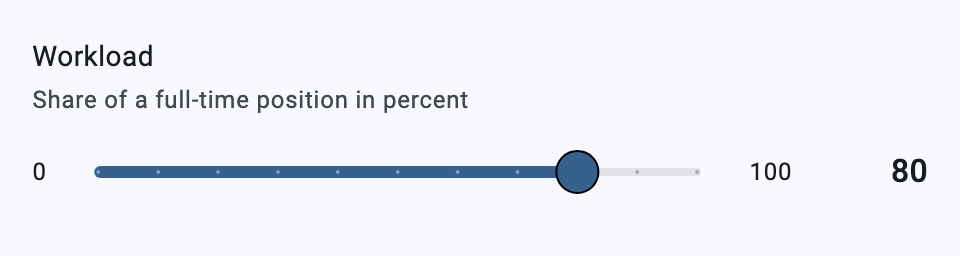 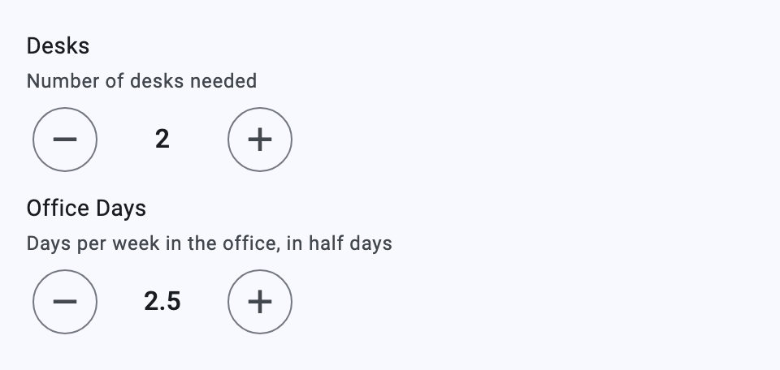

**Segmented and chips editors** read their choices like the dropdowns do: the `const` branches of a `oneOf`/`anyOf` (labelled by their `title`, with the `description` as tooltip) or else plain `enum` values. `segmented` suits two to five short options for one value; tapping the chosen segment again clears it unless the field is required. `chips` edits an `array`: each chip toggles its value, the list is stored in the order of the choices, values the choices don't know are kept, and once `maxItems` is reached the other chips are disabled.

```json
{
  "priority": {
    "type": "string", "title": "Priority", "x-format": "segmented",
    "oneOf": [{"const": "low", "title": "Low"}, {"const": "high", "title": "High"}]
  },
  "allergens": {
    "type": "array", "title": "Allergens", "x-format": "chips",
    "uniqueItems": true, "maxItems": 3,
    "items": {"type": "string", "enum": ["gluten", "nuts", "milk"]}
  }
}
```

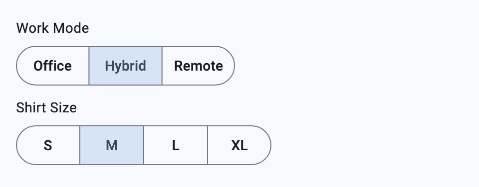 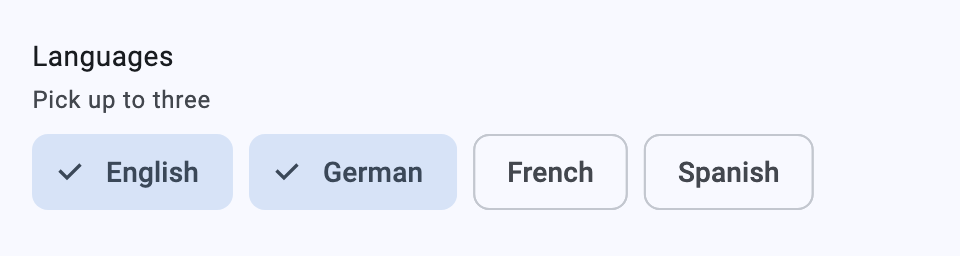

**Duration editor** (`x-format` or the standard `"format": "duration"`) edits hours and minutes. A `string` stores an ISO 8601 duration (`"PT1H30M"`), an `integer`/`number` stores seconds. It reads weeks, days, hours, minutes and seconds (`"P1DT2H"` shows as 26 hours); years and months are ambiguous and show an error. Minutes above 59 carry over into the hours; the seconds of an existing value are kept.

**Signature editor** stores the drawing as a small SVG document (black, round-capped strokes on a 600 × 200 view box, one `<path>` whose subpaths are the strokes), so any SVG renderer — e.g. `SvgPicture.string` — can show it. The pad keeps the 3:1 ratio at every width, wins drags over the surrounding scroll view, and paints on white in light and dark themes alike. `SignatureEditor.parseSvg`/`toSvg` convert between the SVG and the strokes. The pad reads back the SVG it wrote; other SVG shows as empty and is replaced by the next stroke.

```json
{
  "effort": {"type": "string", "title": "Effort", "format": "duration"},
  "signature": {"type": "string", "title": "Signature", "x-format": "signature"}
}
```

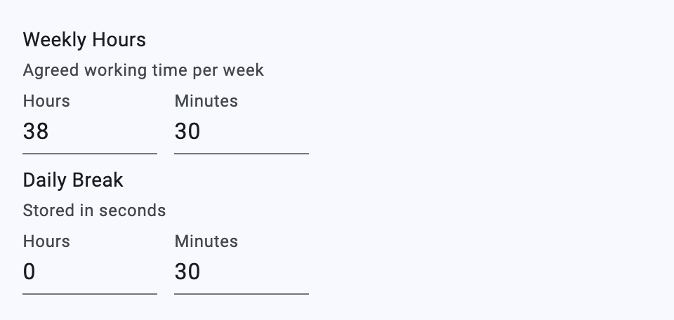 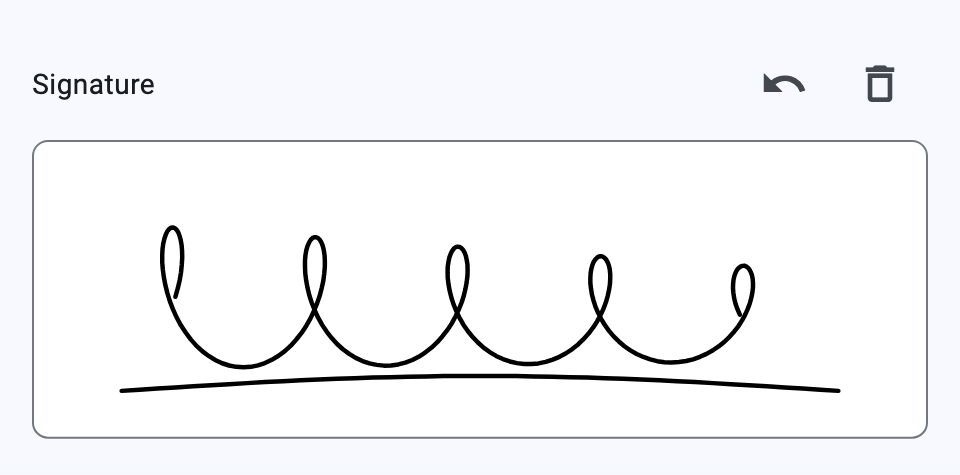

**Image data editor** keeps the picture in the data itself, for forms that travel as one JSON document (offline, to an LLM, into a database column). "Choose picture" opens the photo library on iOS/Android and a file chooser on desktop and web; "Take photo" appears only where the platform has a camera. Pictures are scaled down while picking to fit `x-max-width` × `x-max-height` (default 1024 × 1024) and re-encoded with `x-image-quality` (0–100, default 85), because every byte ends up in the JSON — a 1024 px JPEG is roughly 100–200 KB, a third more as base64. The value is a data URI, so it carries its type; with the standard `"contentEncoding": "base64"` (and, if you like, `"contentMediaType"`) it is plain base64 instead. Both forms are read, and `maxLength` limits the encoded string. The preview shows type and size; stored text that isn't base64 shows an error.

```json
{
  "photo": {
    "type": "string", "title": "Photo", "x-format": "image-data",
    "x-max-width": 800, "x-max-height": 800, "x-image-quality": 80
  },
  "scan": {
    "type": "string", "title": "Scan", "x-format": "image-data",
    "contentEncoding": "base64", "contentMediaType": "image/jpeg"
  }
}
```

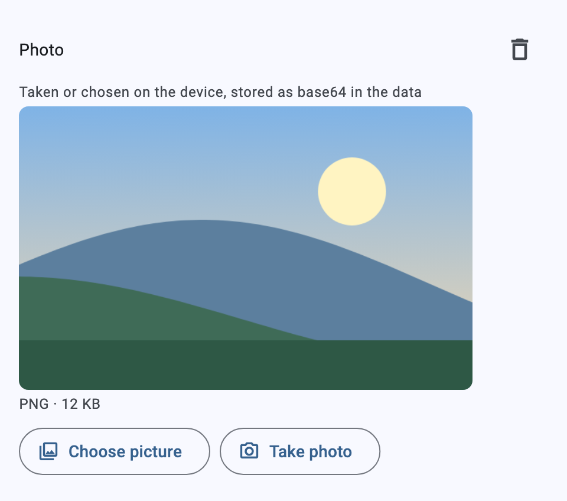

Picking uses the [`image_picker`](https://pub.dev/packages/image_picker) plugin, so the app needs its platform setup: `NSPhotoLibraryUsageDescription` and `NSCameraUsageDescription` in `ios/Runner/Info.plist`, and the `com.apple.security.files.user-selected.read-only` entitlement in both `macos/Runner/*.entitlements`. Android, web, Windows and Linux need nothing extra. `ImageDataEditor.decode`/`encode`/`mimeTypeOf` convert between the stored text and the bytes, e.g. to show the picture elsewhere with `Image.memory`.

**Photo gallery**: `image-data` on an `array` of strings keeps several pictures. Each item is stored like the single editor's value, the size options work the same (on the array or its items), the library picks several at once and `maxItems` caps the count.

```json
{"teamPhotos": {"type": "array", "title": "Team photos", "x-format": "image-data",
                "maxItems": 6, "x-max-width": 800, "items": {"type": "string"}}}
```

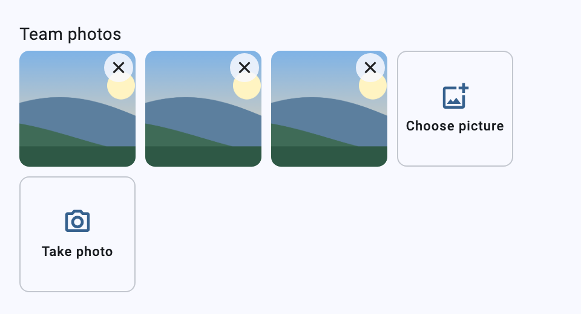

**Scales** suit opinion and satisfaction questions on an `integer`. `linear-scale` shows numbered buttons from `minimum` to `maximum` (default 1–5, at most 11 steps), with optional end labels `x-min-label` and `x-max-label`. `nps` is the Net Promoter Score question, 0–10, with localized end labels unless the schema gives its own. `emoji-scale` shows two to five faces (default 1–5). `x-labels` names each step: the name shows as tooltip, and below the scale for the chosen step. Tapping the chosen step again clears it, unless the field is required.

```json
{
  "satisfaction": {"type": "integer", "title": "How happy are you here?", "x-format": "linear-scale",
                   "minimum": 1, "maximum": 5, "x-min-label": "Not at all", "x-max-label": "Very"},
  "recommend": {"type": "integer", "title": "Would you recommend us?", "x-format": "nps"},
  "mood": {"type": "integer", "title": "Your mood today", "x-format": "emoji-scale",
           "x-labels": ["Awful", "Bad", "Okay", "Good", "Great"]}
}
```

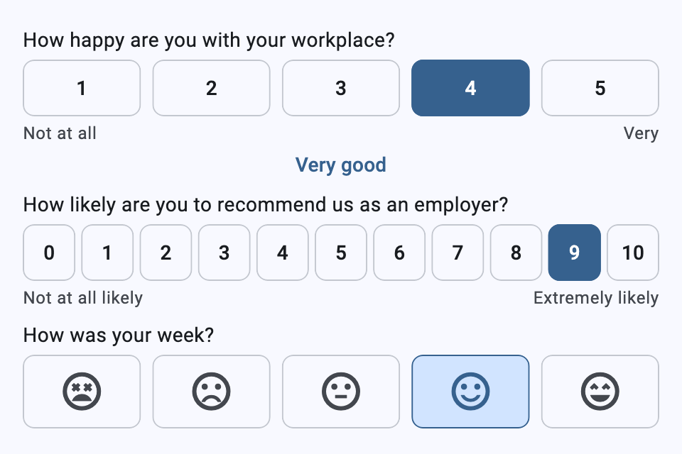

**Matrix** asks several questions with the same answers (a Likert grid) on an `object`. Each property is a row, and the first row's choices (an `enum` or `const`s, typically one shared `$ref`) are the columns. A `string`/`integer` row takes one answer; an `array` row takes several, as checkboxes. Required rows are marked.

```json
{"engagement": {"type": "object", "title": "How much do you agree?", "x-format": "matrix",
  "properties": {"tools": {"title": "I have the tools I need", "$ref": "#/definitions/agree"},
                 "team":  {"title": "My team supports me", "$ref": "#/definitions/agree"}}}}
```

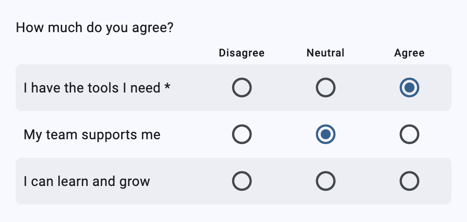

**Ranking** orders the choices of an `array`'s `items` (an `enum` or `const`s). Drag a choice by its handle, or move it with the arrows. The value lists every choice, most preferred first. Until the first move, the field stays empty.

```json
{"priorities": {"type": "array", "title": "What matters most to you?", "x-format": "ranking",
                "uniqueItems": true, "items": {"type": "string", "enum": ["Team", "Growth", "Salary", "Remote work"]}}}
```

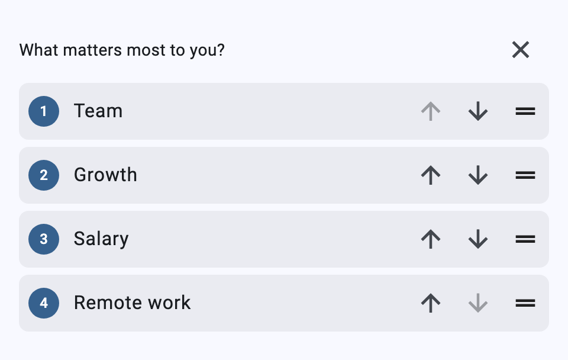

**Date range** picks a start and an end day in one calendar. On an `object`, the first two declared properties name the keys (default `start`/`end`); on a `string`, the value is an ISO 8601 interval. `x-min-date` and `x-max-date` limit the calendar.

**Phone** stores the number in E.164 form, however it was typed. The country list starts at the stored number's country, else `x-default-country`, else the app locale's. `x-countries` limits the list. A number that can't exist in the chosen country shows an error (checked with [`phone_numbers_parser`](https://pub.dev/packages/phone_numbers_parser)).

```json
{
  "vacation": {"type": "object", "title": "Vacation", "x-format": "date-range",
               "properties": {"start": {"type": "string", "format": "date"}, "end": {"type": "string", "format": "date"}}},
  "mobile": {"type": "string", "title": "Mobile", "x-format": "phone",
             "x-default-country": "DE", "x-countries": ["DE", "AT", "CH"]}
}
```

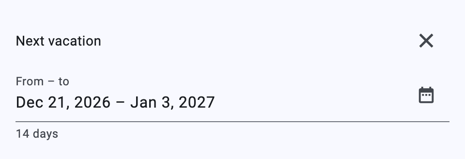 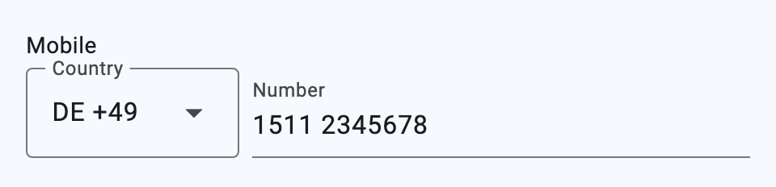

**File data** keeps any file in the data itself, like `image-data` does for pictures. A `string` stores a data URI that carries the name (`data:application/pdf;name=cv.pdf;base64,…`). An `object` stores `{"name", "type", "size", "data"}`. An `array` of either holds several files, up to `maxItems`. `x-accept` (file extensions) or else `contentMediaType` (`image/*` works) filter the chooser. `x-max-file-size` caps each file, in bytes; the default is 5 MiB, since base64 makes every byte a third bigger. Choosing uses the [`file_picker`](https://pub.dev/packages/file_picker) plugin through `FileDataEditor.picker`, which apps and tests can replace. `FileDataEditor.read` turns a stored value back into name, type and bytes. On macOS, `file_picker` needs the `com.apple.security.files.user-selected.read-write` entitlement in both `macos/Runner/*.entitlements` (`read-only`, which the image picker needs too, is enough for choosing files; `read-write` also allows saving them with `FilePicker.saveFile`). Without it, choosing a file fails in the sandboxed app.

```json
{"documents": {"type": "array", "title": "Documents", "x-format": "file-data",
               "maxItems": 3, "x-accept": ["pdf", "docx", "png"], "x-max-file-size": 2000000,
               "items": {"type": "object"}}}
```

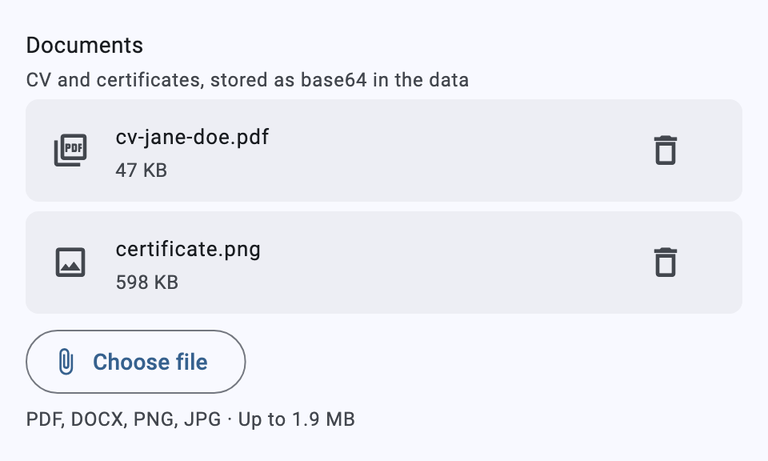

**Units, currencies and masks** need no `x-format`. On a number, `x-unit` puts a unit after the value (`"kg"`, `"%"`), and `x-currency` puts the symbol of an ISO 4217 code before it (`"EUR"` shows `€`); a decimal comma is read as a point. On a string, `x-mask` keeps the text in a fixed pattern: `0` takes a digit, `A` a letter, `*` either, and every other character is written as is. The pattern shows as the hint, and text that doesn't fill it shows an error. The formatted text is stored, or only the typed characters with `"x-mask-raw": true`. `InputMask` is exported for use elsewhere.

**Textarea** is a multi-line `string`, `x-rows` lines high (default 4). It grows up to twice that before it scrolls. With `maxLength`, a counter shows the characters used, and typing stops at the limit.

```json
{
  "salary": {"type": "number", "title": "Expected salary", "x-currency": "EUR", "minimum": 0},
  "bonusRate": {"type": "number", "title": "Bonus", "x-unit": "%", "maximum": 100},
  "iban": {"type": "string", "title": "IBAN", "x-mask": "AA00 0000 0000 0000 0000 00"},
  "feedback": {"type": "string", "title": "Anything else?", "x-format": "textarea", "x-rows": 3, "maxLength": 280}
}
```

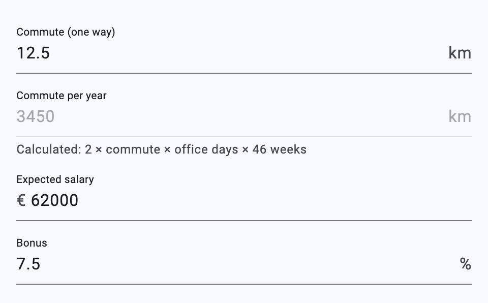 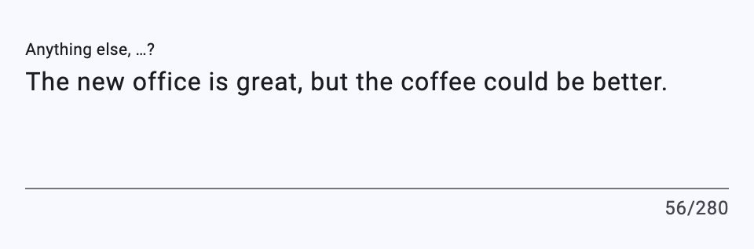

**Consent** is a `boolean` checkbox whose title is Markdown, so it can link to the terms. Links open through `ConsentEditor.openLink`, which uses the browser by default and can be replaced. Ticking stores `true`. If the field is required or has `"const": true`, unticking clears the value and shows that consent is needed; otherwise unticking stores `false`.

```json
{"privacy": {"type": "boolean", "const": true, "x-format": "consent",
             "title": "I accept the [privacy policy](https://example.com/privacy)"}}
```

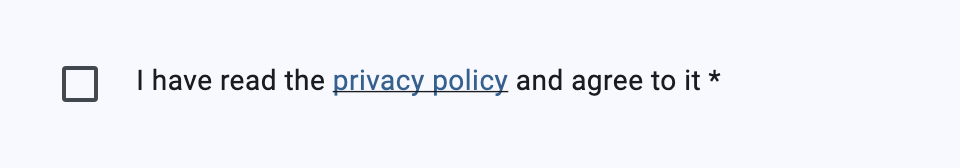

All of these fall back to the editor the field would get without the `x-format` when the schema doesn't fit (e.g. `slider` on a string, `chips` without choices).

The screenshots come from the example app's schema; `cd example && flutter test screenshots` renders them again into `doc/images/`.

**Star rating editor** works with both `"type": "integer"` (stores `int`) and `"type": "string"` (stores `String`). Clicking a star sets the rating; clicking the same star again resets to 0.

**Image picker** supports two modes:
- **Simple enum** — each `enum` value is an image URL; the selected URL is stored as the value.
- **Remote `$ref`** — resolves a remote reference via `onRefLookup`. The response's `enumSource` is parsed: `title` is treated as the image URL, `value` (e.g. an ID) is stored as the result.

**SVG part picker** renders any SVG asset and lets users toggle selection of regions. Selectable elements are identified by having both an `id` and a `data-state` attribute. The `x-svg-asset` schema property specifies the asset path. IDs present in the data but not found in the SVG are preserved, allowing multiple SVGs to edit different aspects of the same dataset without data loss.

You can override a built-in format editor by providing your own builder for the same key in `formatOverrides`.

### Resolution Priority

Registry overrides are checked in this order (first match wins):

1. **Path overrides** — exact field path match
2. **Format overrides** — `x-format` value match, then standard `format` fallback (includes built-in defaults)
3. **Predicate overrides** — first matching predicate
4. **Type overrides** — schema type match

## Remote References

Resolve external `$ref` URLs (e.g. for enum lookups from an API) by providing an `onRefLookup` callback:

```dart
JsonEditor(
  schema: schema,
  onRefLookup: (url) async {
    final response = await http.get(Uri.parse(url));
    return json.decode(response.body) as List<Map<String, dynamic>>;
  },
  minTypeAhead: 10, // switch from dropdown to typeahead above this count
)
```

Results are cached per URL for the lifetime of the widget.

## Supported Schema Features

| Feature | Support |
|---|---|
| Basic types (string, number, integer, boolean) | Full |
| Enum | Full |
| Objects with properties | Full |
| Nested objects | Full |
| Arrays (homogeneous + tuple) | Full |
| Maps (additionalProperties) | Full |
| `oneOf` / `anyOf` composition | Full |
| `if` / `then` / `else` conditionals | Full |
| Property & schema dependencies | Full |
| `$ref` (local) | Full, with circular depth protection |
| `$ref` (remote URL) | Via async callback |
| `readOnly` / `writeOnly` | Full |
| `const` values | Full (rendered read-only) |
| Nullable types | Full (clear button) |
| `minItems` / `maxItems` | Full |
| `minimum` / `maximum` | Validation |
| `format` (email, uri) | Validation |
| `format` / `x-format` (colour/color) | Built-in colour wheel editor |
| `format` / `x-format` (star-rating) | Built-in star rating editor |
| `format` / `x-format` (image-url-picker) | Built-in image picker editor |
| `x-format` (image-choice) | Built-in picture choice editor (`oneOf` of `const`s with `x-image`) |
| `x-format` (slider, stepper) | Built-in slider and − / + counter for numbers |
| `x-format` (segmented) | Built-in segmented single choice (`enum` or `oneOf` of `const`s) |
| `x-format` (chips) | Built-in filter-chip multiple choice for arrays |
| `format` / `x-format` (duration) | Built-in hours/minutes editor (ISO 8601 or seconds) |
| `x-format` (signature) | Built-in signature/sketch pad (SVG) |
| `x-format` (image-data) | Built-in photo from library or camera, stored as base64 (`contentEncoding`, `x-max-width`, `x-max-height`, `x-image-quality`) |
| `x-format` (image-data on an array) | Built-in photo gallery |
| `x-format` (linear-scale, nps, emoji-scale) | Built-in rating scales for integers |
| `x-format` (matrix) | Built-in Likert grid for objects |
| `x-format` (ranking) | Built-in drag-to-order for arrays of choices |
| `x-format` (date-range) | Built-in date-range picker (object or ISO 8601 interval) |
| `x-format` (phone) | Built-in international phone number (E.164) |
| `x-format` (file-data) | Built-in file upload stored as base64 (`x-accept`, `x-max-file-size`) |
| `x-format` (consent) | Built-in consent checkbox with Markdown links |
| `x-format` (textarea) | Built-in multi-line text (`x-rows`) |
| `x-unit`, `x-currency`, `x-mask` | Number suffix/currency symbol, string input mask |
| `x-layout` (card, collapsible, plain, wizard, tabs) | Section layouts |
| `x-hidden`, `x-calc`, `{{…}}` in titles | Hidden, calculated (JSON Logic) and piped fields |
| `format` / `x-format` (date) | Built-in date picker |
| `format` / `x-format` (time) | Built-in time picker (dropdowns) |
| `format` / `x-format` (date-time) | Built-in combined date-time picker |
| `format` / `x-format` (markdown) | Built-in Markdown renderer/editor |
| `x-format` (svg-part-picker) | Built-in interactive SVG region picker |
| `default` values | Applied on field creation |
| Reorderable arrays | Full (drag handles) |

## Localization

The editor is fully localized using Flutter's `gen-l10n` tooling. Out of the box it ships with English (`en`) and German (`de`).

### Changing Strings

Edit the `.arb` files in `lib/src/l10n/`:

- `json_editor_en.arb` — English (template)
- `json_editor_de.arb` — German

Then regenerate the Dart localization classes:

```bash
$ flutter gen-l10n
$ cd example; flutter gen-l10n
```

The generated files are written to `lib/src/l10n/generated/` as configured in `l10n.yaml`.

### Adding a New Locale

1. Copy the template file to a new `.arb` file with the target locale suffix, e.g. for French:
   ```bash
   cp lib/src/l10n/json_editor_en.arb lib/src/l10n/json_editor_fr.arb
   ```
2. Update `"@@locale": "fr"` at the top of the new file.
3. Translate all the string values.
4. Run `flutter gen-l10n` to regenerate.

The new locale is automatically picked up — no additional registration is needed.

### Using Localizations in Your App

Make sure your `MaterialApp` includes the editor's localization delegate and supported locales:

```dart
import 'package:flutter_json_editor/flutter_json_editor.dart';

MaterialApp(
  localizationsDelegates: const [
    JsonEditorLocalizations.delegate,
    // From material_ui, including the widgets and Cupertino delegates.
    ...GlobalMaterialLocalizations.delegates,
  ],
  supportedLocales: JsonEditorLocalizations.supportedLocales,
  // ...
)
```

## Example

Check out the [example project](./example) to see the editor in action with an employee record schema that exercises most of these features — nested objects, arrays, maps, conditionals, remote refs, and more.

## Requirements

- Flutter >= 3.47.0
- Dart SDK >= 3.13.0
- [`material_ui`](https://pub.dev/packages/material_ui) >= 1.6.0

## License

See [LICENSE](LICENSE) for details.
